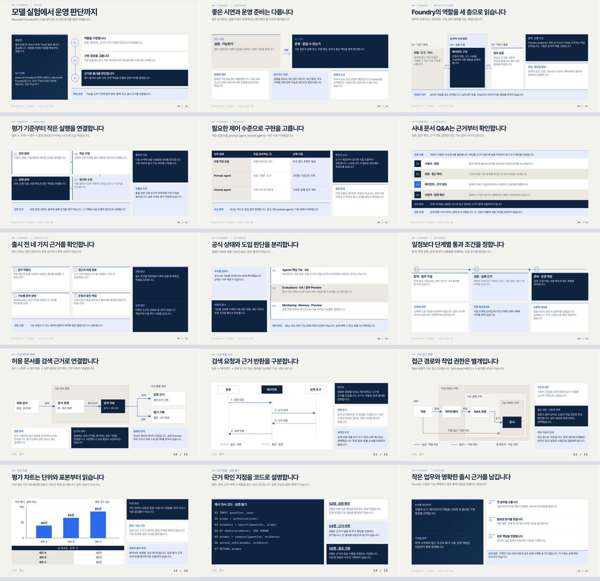
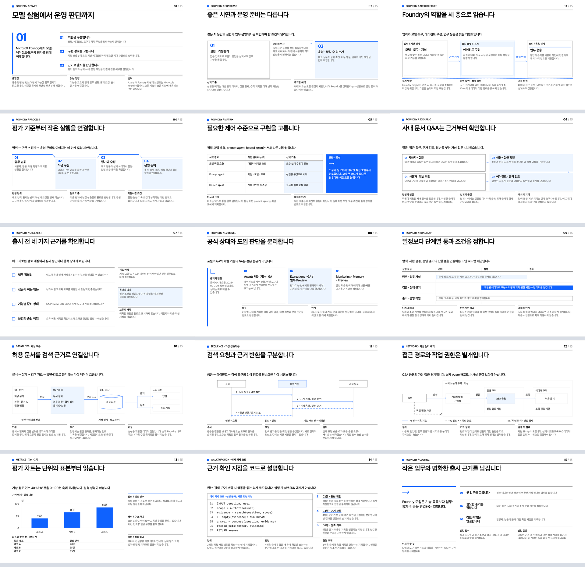

# doc-and-deck-skills

Markdown 원고나 주제로 **읽는 HTML 문서와 PowerPoint**를 만드는 에이전트 스킬 11개입니다.
디자인은 **Deep Navy**와 **White Cobalt** 두 가지이며, 각각 템플릿 20종을 제공합니다.
테마별 스킬 10개와 **원본 PowerPoint 보존용 `pptx-to-html` 1개**로 구성됩니다.

## 설치

```sh
git clone https://github.com/hijigoo/doc-and-deck-skills.git
mkdir -p ~/.copilot/skills
cp -R doc-and-deck-skills/skills/* ~/.copilot/skills/
```

Copilot CLI에서 `/skills reload`를 실행하면 바로 쓸 수 있습니다.
필요한 스킬 폴더만 복사해도 되며, `SKILL.md`만이 아니라 **폴더 전체**를 복사하세요.

## 사용법

에이전트 대화창에 `/스킬명` 뒤에 **입력 파일 또는 만들고 싶은 주제**만 적으면 됩니다.
필요하면 대상 독자·목적·다룰 내용을 덧붙이세요.
디자인·템플릿 선택·출력 형식·단일 HTML 구성·검사는 스킬이 처리하므로 반복해서 지정할 필요가 없습니다.

### Deep Navy

```text
/deep-navy-md-to-html notes.md
/deep-navy-topic-to-html 개발팀을 위한 Microsoft Foundry 소개. 모델 선택, 에이전트 개발, 평가와 운영을 다뤄줘.
/deep-navy-md-to-pptx notes.md
/deep-navy-html-to-pptx deck.html
/deep-navy-pptx-to-html slides.pptx
```

### White Cobalt

```text
/white-cobalt-md-to-html notes.md
/white-cobalt-topic-to-html 개발팀을 위한 Microsoft Foundry 소개. 모델 선택, 에이전트 개발, 평가와 운영을 다뤄줘.
/white-cobalt-md-to-pptx notes.md
/white-cobalt-html-to-pptx deck.html
/white-cobalt-pptx-to-html slides.pptx
```

### pptx-to-html · 원본 PowerPoint 보존

```text
/pptx-to-html "발표 자료.pptx"
```

원본 슬라이드와 발표 노트를 같은 폴더의 `발표 자료.html` 하나로 만듭니다.
**Microsoft PowerPoint가 필수**이며 LibreOffice로 대체하지 않습니다.
White Cobalt는 바깥 읽기 UI에만 적용하고 원본 슬라이드는 다시 디자인하지 않습니다.
슬라이드 순서·비율·제목·노트·원문 텍스트·링크를 보존하며, 목차·노트 접기·확대·인쇄를 제공합니다.
결과는 정적 화면으로, 애니메이션·동영상·편집 가능한 슬라이드를 재현하지 않습니다.
전체 작업 절차는 [pptx-to-html 스킬 지침](skills/pptx-to-html/SKILL.md)을 보세요.

## 스킬

테마별 스킬 10개의 이름은 `<테마>-<경로>`입니다. 테마는 `deep-navy` 또는 `white-cobalt`입니다.
별도 원본 보존 스킬 [pptx-to-html](skills/pptx-to-html/SKILL.md)도 제공합니다.

| 경로 | 입력 → 출력 | Deep Navy 샘플 | White Cobalt 샘플 |
|---|---|---|---|
| `md-to-html` | Markdown → HTML | [HTML 보기](https://hijigoo.github.io/doc-and-deck-skills/samples/deep-navy-md-to-html/foundry.html) | [HTML 보기](https://hijigoo.github.io/doc-and-deck-skills/samples/white-cobalt-md-to-html/foundry.html) |
| `topic-to-html` | 주제 → 조사 → HTML | [HTML 보기](https://hijigoo.github.io/doc-and-deck-skills/samples/deep-navy-topic-to-html/topic.html) | [HTML 보기](https://hijigoo.github.io/doc-and-deck-skills/samples/white-cobalt-topic-to-html/topic.html) |
| `md-to-pptx` | Markdown → PPTX | [PPTX](samples/deep-navy-md-to-pptx/foundry.pptx) | [PPTX](samples/white-cobalt-md-to-pptx/foundry.pptx) |
| `html-to-pptx` | HTML → PPTX | [PPTX](samples/deep-navy-html-to-pptx/foundry.pptx) | [PPTX](samples/white-cobalt-html-to-pptx/foundry.pptx) |
| `pptx-to-html` | PPTX → HTML | [HTML 보기](https://hijigoo.github.io/doc-and-deck-skills/samples/deep-navy-pptx-to-html/index.html) | [HTML 보기](https://hijigoo.github.io/doc-and-deck-skills/samples/white-cobalt-pptx-to-html/index.html) |

| 별도 스킬 | 입력 → 출력 | 특징 |
|---|---|---|
| [pptx-to-html](skills/pptx-to-html/SKILL.md) | PPTX → 단일 HTML | PowerPoint 직접 렌더 필수, 원본 화면·노트 보존, White Cobalt 읽기 UI |

- **HTML 보기**를 클릭하면 GitHub Pages에서 바로 열립니다. HTML 결과는 폰트·이미지·스크립트를 내장한 파일 하나이며, 내려받아 오프라인으로도 볼 수 있습니다.
- HTML에는 목차, 장별 설명·발표 스크립트, 키보드 조작, 모바일·인쇄 화면이 포함됩니다.
- `pptx-to-html`은 원본 슬라이드를 다시 디자인하지 않고 그대로 보존합니다.

기존 테마별 스킬 10개의 샘플은 Microsoft Foundry를 주제로 만든 20장 자료입니다.
새 `pptx-to-html`의 전용 샘플은 아직 없습니다. 자세한 내용은 [samples/README.md](samples/README.md)를 보세요.

## 템플릿 20종

`cover` · `contrast` · `architecture` · `process` · `matrix` · `scenario` · `checklist` ·
`evidence` · `roadmap` · `dataflow` · `sequence` · `network` · `metrics` · `walkthrough` ·
`decision` · `pyramid` · `funnel` · `riskmap` · `swimlane` · `closing`

전체 디자인은 [Deep Navy 갤러리](https://hijigoo.github.io/doc-and-deck-skills/skills/deep-navy-md-to-html/deck.html)와
[White Cobalt 갤러리](https://hijigoo.github.io/doc-and-deck-skills/skills/white-cobalt-md-to-html/deck.html)에서 바로 볼 수 있습니다.
맞는 템플릿이 없으면 같은 디자인 원칙으로 새 레이아웃을 만듭니다.





## 요구 사항

- HTML 보기: 브라우저
- HTML 조립: Python 3.9+
- PPTX 생성·검사: Node.js 22+, 각 스킬의 `package.json`·`requirements.txt`
- PPTX 미리보기: LibreOffice 또는 PowerPoint, Poppler
- `pptx-to-html`: **Microsoft PowerPoint**, Python 3, Poppler 필수. macOS 자동화에는 앱 제어 권한이 필요할 수 있습니다.

## 샘플 다시 만들기

```sh
npm --prefix samples ci
python3 -m venv samples/.venv && samples/.venv/bin/pip install -r samples/requirements.txt
PYTHON="$PWD/samples/.venv/bin/python" npm --prefix samples run build
npm --prefix samples test && npm --prefix samples run verify
```

## 참고

- PPTX에는 폰트를 넣지 않았습니다. [동봉 폰트](samples/assets/fonts/)를 설치하거나 PDF로 확인하세요.
- PowerPoint 앱에서의 열기와 애니메이션 재생은 직접 확인하지 않았습니다.
- 샘플의 절차·수치·코드는 설명용 예시이며 실제 배포나 성능 측정 결과가 아닙니다.
