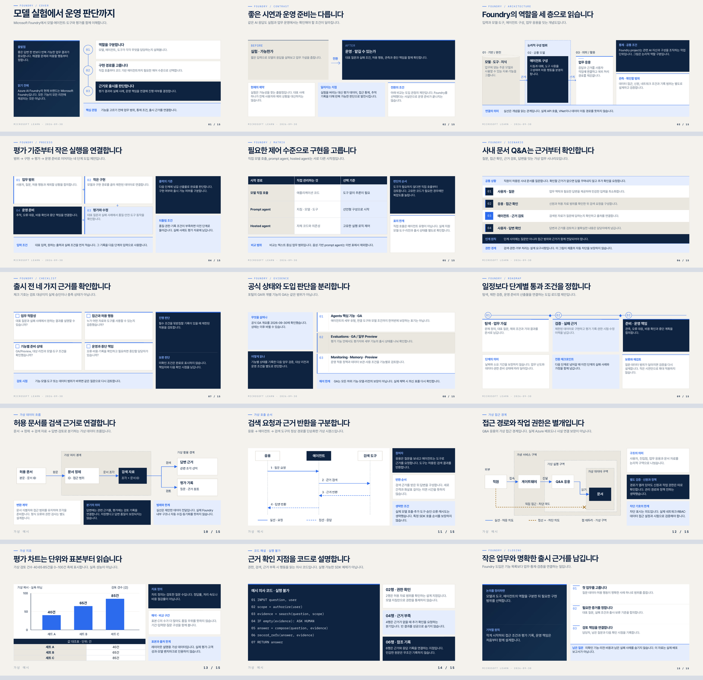
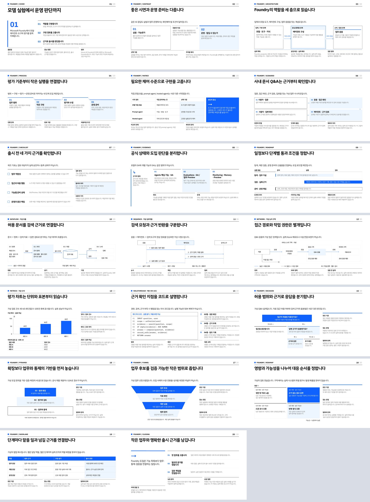

# Microsoft Foundry 샘플

10개 스킬로 만든 20장 샘플입니다. 각 샘플은 테마별 템플릿 20종을 한 번씩 사용합니다.





## 결과 파일

| 스킬 | 결과 | 미리보기 |
|---|---|---|
| `deep-navy-md-to-html` | [foundry.html](deep-navy-md-to-html/foundry.html) | [PNG](previews/deep-navy-md-to-html/overview.png) |
| `deep-navy-topic-to-html` | [topic.html](deep-navy-topic-to-html/topic.html) | [PNG](previews/deep-navy-topic-to-html/overview.png) |
| `deep-navy-md-to-pptx` | [foundry.pptx](deep-navy-md-to-pptx/foundry.pptx) | [PNG](previews/deep-navy-md-to-pptx/overview.png) · [PDF](deep-navy-md-to-pptx/foundry.pdf) |
| `deep-navy-html-to-pptx` | [foundry.pptx](deep-navy-html-to-pptx/foundry.pptx) | [PNG](previews/deep-navy-html-to-pptx/overview.png) · [PDF](deep-navy-html-to-pptx/foundry.pdf) |
| `deep-navy-pptx-to-html` | [index.html](deep-navy-pptx-to-html/index.html) | [PNG](previews/deep-navy-pptx-to-html/overview.png) |
| `white-cobalt-md-to-html` | [foundry.html](white-cobalt-md-to-html/foundry.html) | [PNG](previews/white-cobalt-md-to-html/overview.png) |
| `white-cobalt-topic-to-html` | [topic.html](white-cobalt-topic-to-html/topic.html) | [PNG](previews/white-cobalt-topic-to-html/overview.png) |
| `white-cobalt-md-to-pptx` | [foundry.pptx](white-cobalt-md-to-pptx/foundry.pptx) | [PNG](previews/white-cobalt-md-to-pptx/overview.png) · [PDF](white-cobalt-md-to-pptx/foundry.pdf) |
| `white-cobalt-html-to-pptx` | [foundry.pptx](white-cobalt-html-to-pptx/foundry.pptx) | [PNG](previews/white-cobalt-html-to-pptx/overview.png) · [PDF](white-cobalt-html-to-pptx/foundry.pdf) |
| `white-cobalt-pptx-to-html` | [index.html](white-cobalt-pptx-to-html/index.html) | [PNG](previews/white-cobalt-pptx-to-html/overview.png) |

HTML은 파일 하나만 내려받아 브라우저에서 열면 됩니다.

## 샘플 프롬프트

저장소 루트에서 사용할 호출 예시이며 과거 실행 로그는 아닙니다.
입력 파일이나 콘텐츠 요구만 전달하고, 형식·디자인·검사는 스킬에 맡깁니다.

```text
/deep-navy-md-to-html samples/shared/foundry.md
/deep-navy-topic-to-html 개발팀을 위한 Microsoft Foundry 소개. 모델 선택, 에이전트 개발, 평가와 운영을 다뤄줘.
/deep-navy-md-to-pptx samples/shared/foundry.md
/deep-navy-html-to-pptx samples/deep-navy-md-to-html/foundry.html
/deep-navy-pptx-to-html samples/deep-navy-html-to-pptx/foundry.pptx
/white-cobalt-md-to-html samples/shared/foundry.md
/white-cobalt-topic-to-html 개발팀을 위한 Microsoft Foundry 소개. 모델 선택, 에이전트 개발, 평가와 운영을 다뤄줘.
/white-cobalt-md-to-pptx samples/shared/foundry.md
/white-cobalt-html-to-pptx samples/white-cobalt-md-to-html/foundry.html
/white-cobalt-pptx-to-html samples/white-cobalt-html-to-pptx/foundry.pptx
```

## 장별 템플릿

| 장 | 템플릿 | 장 | 템플릿 |
|---|---|---|---|
| 01 | `cover` | 11 | `sequence` |
| 02 | `contrast` | 12 | `network` |
| 03 | `architecture` | 13 | `metrics` |
| 04 | `process` | 14 | `walkthrough` |
| 05 | `matrix` | 15 | `decision` |
| 06 | `scenario` | 16 | `pyramid` |
| 07 | `checklist` | 17 | `funnel` |
| 08 | `evidence` | 18 | `riskmap` |
| 09 | `roadmap` | 19 | `swimlane` |
| 10 | `dataflow` | 20 | `closing` |

## 원고와 출처

- [공통 원고](shared/foundry.md) · [주제 조사 범위](shared/topic-brief.md) · [공식 출처](shared/sources.json)
- 출처는 Microsoft Learn 문서이며 확인일은 2026-09-30입니다.
- 절차·차트·코드는 설명용 예시입니다. 실제 배포나 성능 측정 결과가 아닙니다.

## 다시 만들기

Node.js 22+, Python 3.9+, LibreOffice, Poppler가 필요합니다. `samples/`에서 실행합니다.

```sh
npm ci
python3 -m venv .venv && .venv/bin/pip install -r requirements.txt
PYTHON="$PWD/.venv/bin/python" npm run build
npm test && npm run verify
```

검사 기록: [HTML](validation.json) · [PPTX](content-validation.json) · [템플릿 대응](catalog.json)

## 참고

- PPTX에는 폰트를 넣지 않았습니다. [동봉 폰트](assets/fonts/)를 설치하거나 PDF로 확인하세요.
- PowerPoint 앱에서의 열기와 애니메이션 재생은 직접 확인하지 않았습니다.
- `pptx-to-html` 결과의 슬라이드는 원본을 보존한 정적 렌더입니다.
